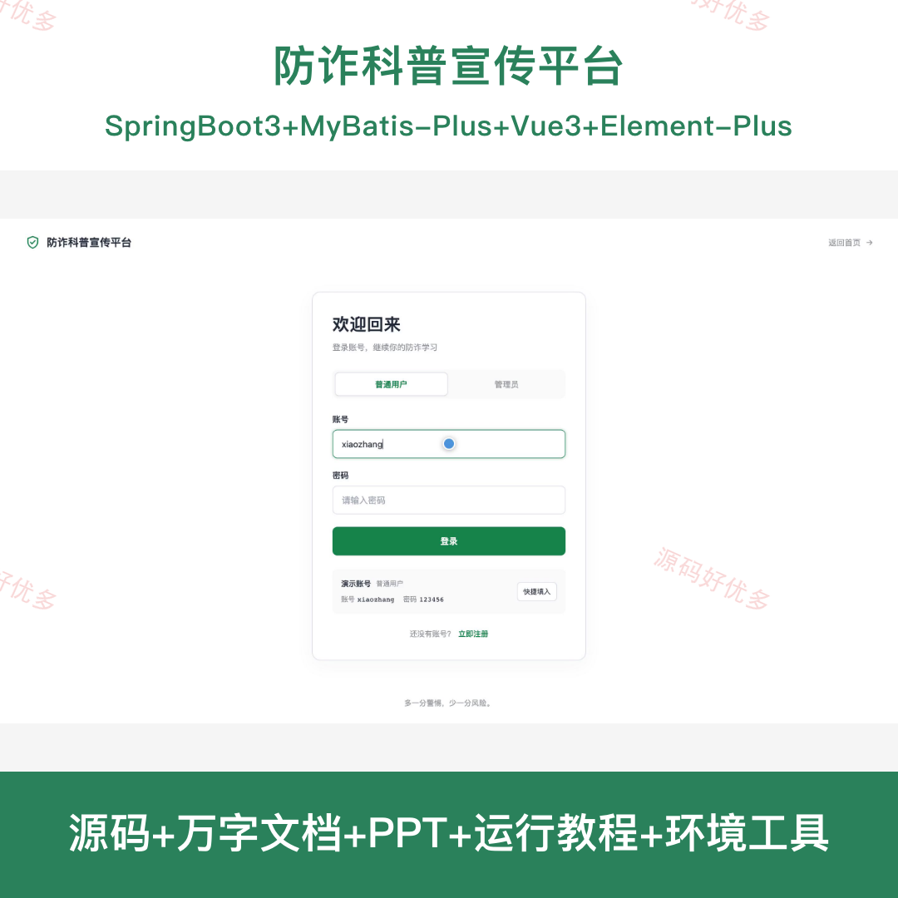
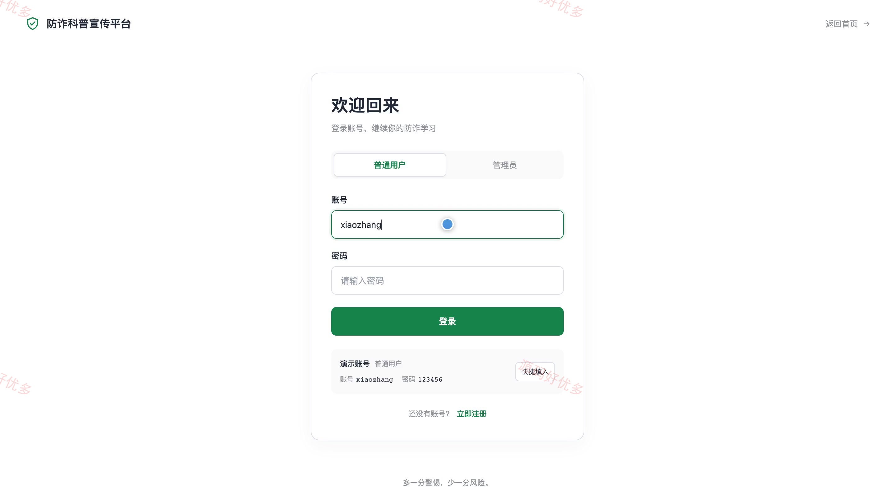
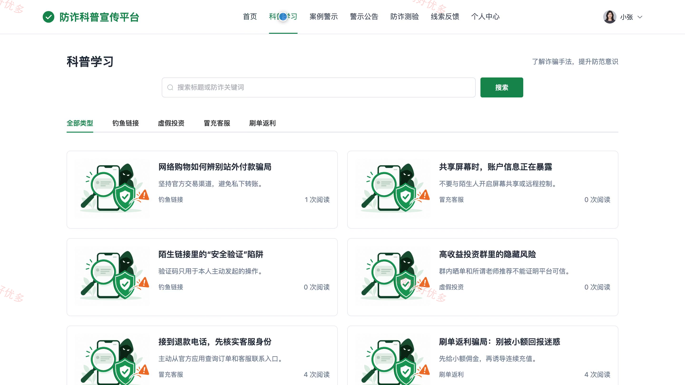
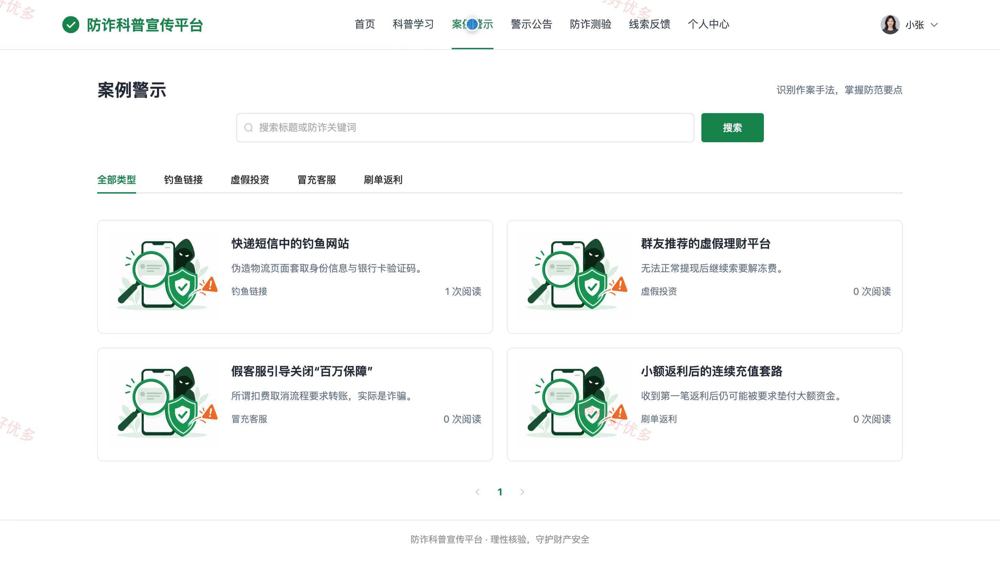
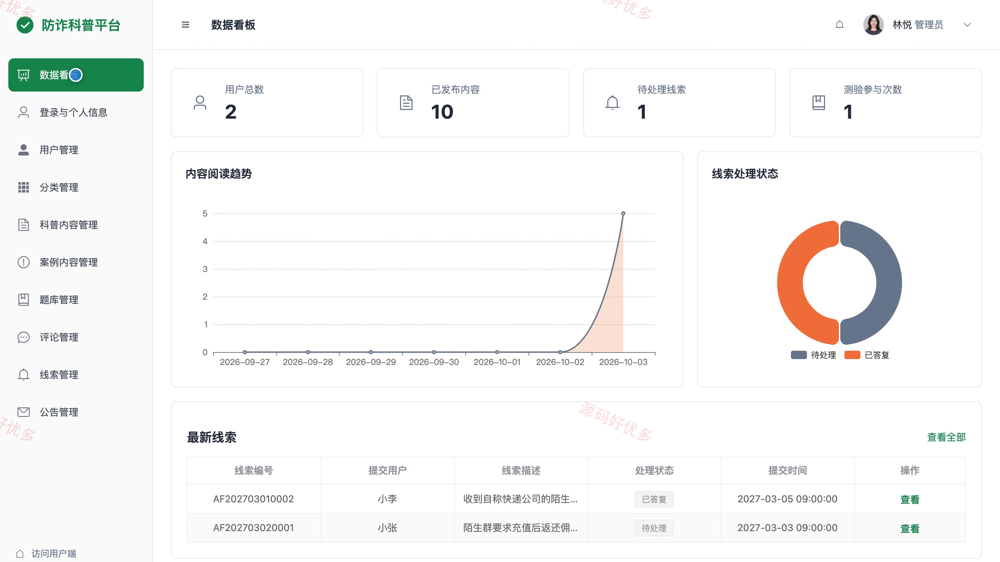
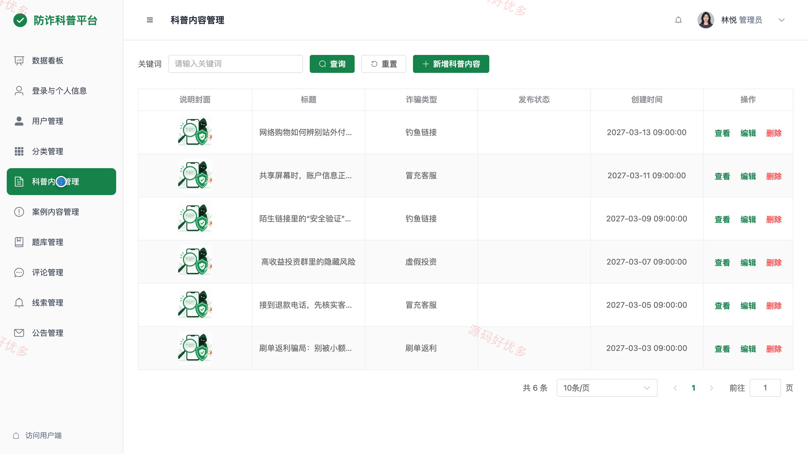
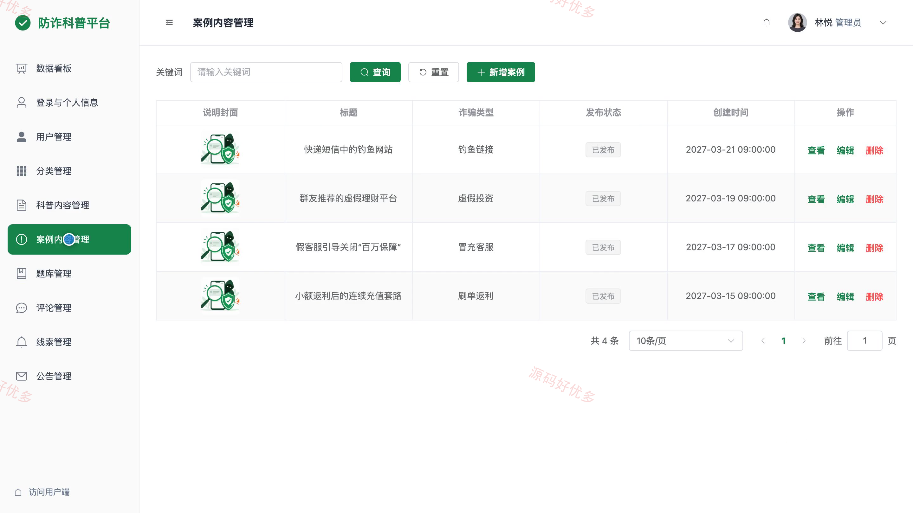

## 源码问题查看主页咨询

### 一、关键词
防诈科普、反诈骗宣传、网络安全教育、诈骗案例警示、防骗知识测验

### 二、作品包含
源码+数据库+万字设计文档+PPT+全套环境和工具资源+本地部署教程

### 三、项目技术
前端技术： Html、Css、Js、Vue3.4、Element-Plus
后端技术：Java、SpringBoot3.2.0、MyBatis-Plus

### 四、运行环境要求
开发工具：IDEA/eclipse + VSCODE

数据库：MySQL5.7+（共13张表）

数据库管理工具：Navicat10以上版本

环境配置软件： JDK17 + Maven3.6

前端Nodejs：16+

浏览器：谷歌浏览器

### 五、项目介绍
项目编号：bs148A

防诈科普宣传平台面向普通用户提供防诈文章、诈骗案例、警示公告、分类测验与线索反馈；管理员维护宣传内容、题库和用户反馈，并查看平台数据。

角色：用户、管理员

用户功能：注册登录与个人资料维护、按诈骗类型浏览和搜索科普文章与案例、查看警示公告与文章评论、收藏内容并查看阅读记录、参加分类测验并查看成绩解析、复习错题和查看学习进度、提交疑似诈骗线索并查看回复。

管理员功能：用户账号查询与启停管理、诈骗分类与科普文章管理、案例内容与警示公告发布管理、测验题目和答案解析管理、评论回复与隐藏处理、疑似诈骗线索查看与回复、平台数据统计。

### 六、运行截图

